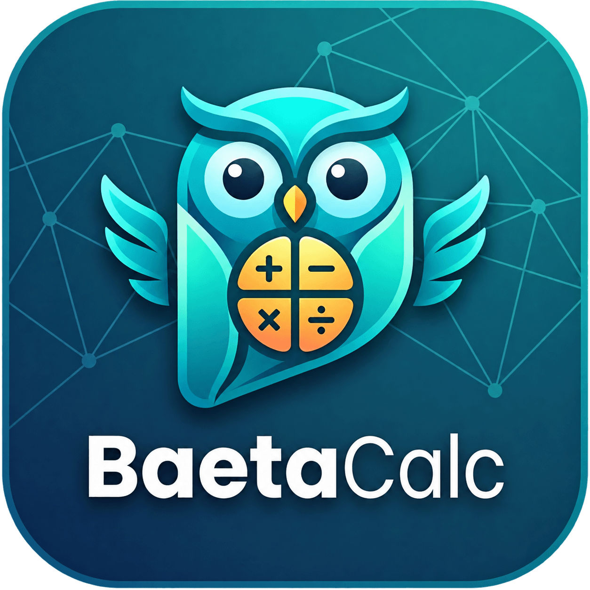
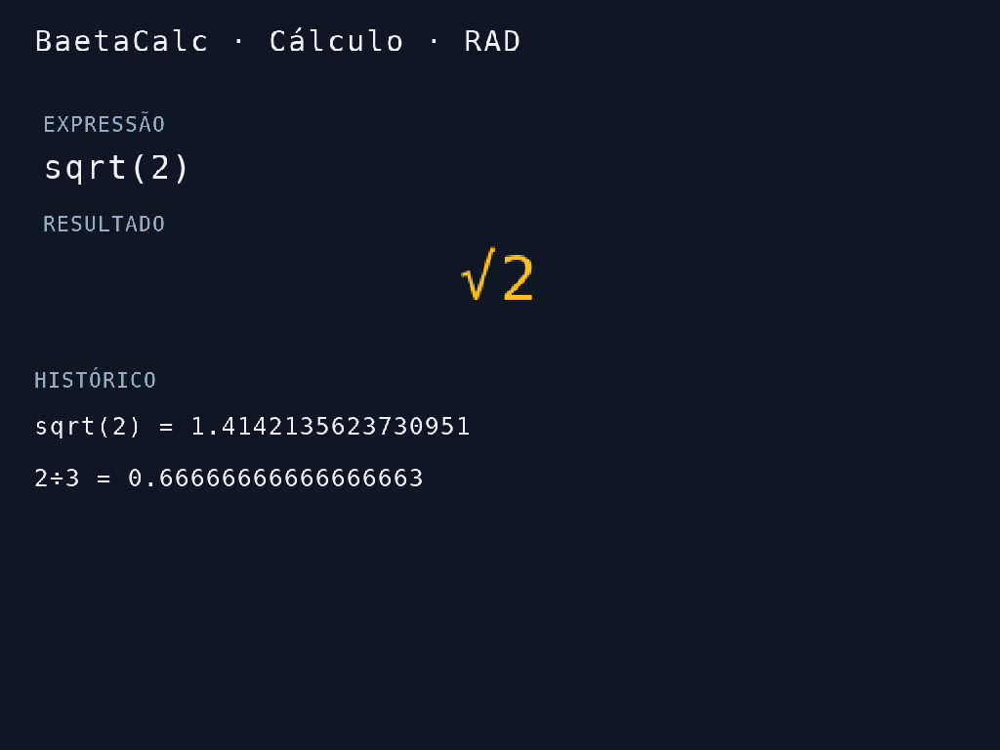
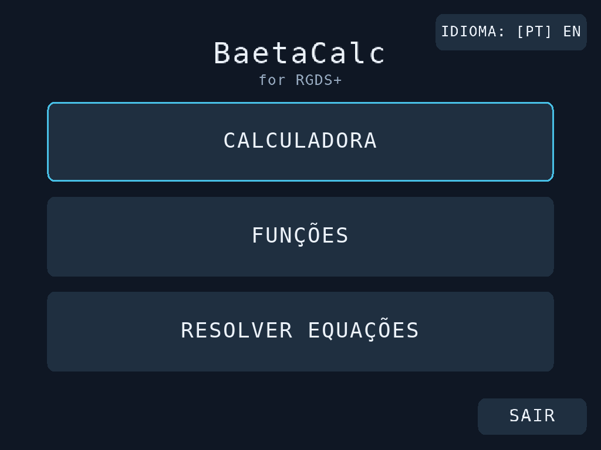
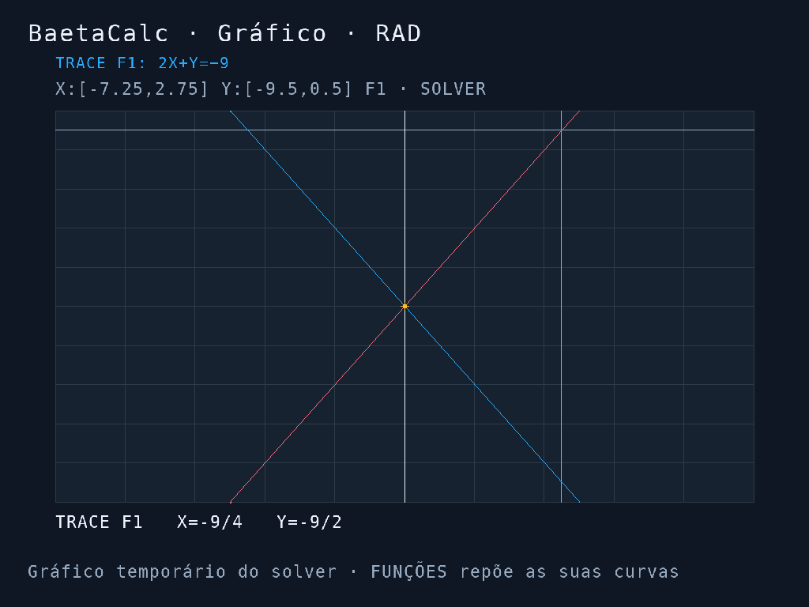

# BaetaCalc

[⬇ Descarregar / Download](https://github.com/PolluxPT/BaetaCalc/releases/latest)

# Calculadora científica e gráfica para a RGDS+ com Linux Stock OS.

[English](README_EN.md) · [Manual PT](docs/MANUAL_PT.txt) · [Compilação / Build](docs/BUILD.md) · [Licença MIT](LICENSE)

Calculadora normal e científica, gráficos com sombreado e resolução de equações,
com menus em português de Portugal e inglês. Desenvolvida por Filipe Baeta.

## Instalar na consola

1. Abra **Releases**, na página deste repositório.
2. Descarregue o ficheiro **BaetaCalc_2_5_Final_PT_EN_RGDSPlus.zip** dos anexos da Release.
   O ZIP automático **Source code** do GitHub contém o código, não a aplicação pronta.
3. Extraia o ZIP e copie **BaetaCalc.sh** e a pasta **BaetaCalc**, que estão dentro
   de **APPS**, para **Roms/APPS** no cartão de jogos.
   Copie também **Imgs/BaetaCalc.png**: o logótipo deve ficar em
   **Roms/APPS/Imgs/BaetaCalc.png**.
4. Abra **BaetaCalc** no menu APPS da consola.

Para atualizar, substitua os ficheiros sem apagar previamente a pasta BaetaCalc.
Os ficheiros de estado, idioma e calibração existentes devem ser preservados.
O relatório de arranque é único e fica dentro da pasta da aplicação.
A aplicação também funciona sem uma calibração importada do ScummVM, usando o
mapeamento normalizado de toque; o lançador importa essa calibração se existir.

## Funcionalidades

- Calculadora normal e científica, histórico da sessão e edição com cursor.
- Frações e radicais exatos nos casos suportados: `sqrt(8)` → `2√2`,
  `sqrt(8)*sqrt(5)` → `2√10`, `1/sqrt(2)` → `√2/2`.
- Seis funções, `Y=f(X)` e `X=f(Y)`, retas horizontais e verticais.
- Gráfico, tabela, TRACE, deslocamento da janela, zoom e interseção de sombras.
- Polinómios de graus 1–6, equação em X num intervalo, sistemas lineares
  de duas/três variáveis e sistemas não lineares de duas variáveis.
- Interface PT/EN, confirmação de saída e reset completo sem reiniciar.

O menu inicial separa Calculadora, Funções e Resolver Equações.
O botão **A/B** alterna a apresentação decimal/exata; conserva o decimal quando
não consegue confirmar uma forma exata suportada a partir da expressão.

## Controlos

| Controlo | Ação |
|---|---|
| Toque / A | Ativar uma tecla |
| D-pad | Navegar; no gráfico, deslocar a janela |
| B | Apagar na edição; voltar nos painéis |
| START | Confirmar/calcular conforme o contexto |
| Y | Trocar os ecrãs |
| L / R | Zoom do gráfico |
| L2 + R2 | Limpar a memória matemática, incluindo funções e equações |
| POWER, toque curto | Solicitar suspensão; outro toque deve retomar |

## Compatibilidade e limites

- Destino: **RGDS+**, firmware **Linux Stock OS**, ARM64/aarch64, SDL2 do sistema.
- Não há compatibilidade confirmada com RGDS sem Plus, RG35XXSP ou outras consolas.
- **POWER/suspensão e retoma dependem do firmware e ainda precisam de validação em hardware.**
- O motor numérico usa ponto flutuante. A apresentação exata tem limites explícitos;
  não é um sistema de álgebra simbólica geral e não torna exato todo o cálculo.
- Os métodos numéricos podem não encontrar todas as soluções. Um sistema não linear
  procura uma solução perto dos valores iniciais. Não há gráficos 3D.
- Gráficos e sombreado são amostrados; não é calculada a área da região pintada.

## Desenvolvimento e testes

Código em `src`, testes em `tests`, atlas da fonte em `assets` e lançador em
`launcher`. Consulte [docs/BUILD.md](docs/BUILD.md) para compilar, testar e empacotar.
Os testes de matemática, radicais, interface, persistência e navegação foram
executados num computador Linux. As imagens são capturas renderizadas no computador,
com exemplos de teste; não são fotografias da consola.

## Reportar problemas

Abra uma **Issue** com modelo da consola, firmware, versão da aplicação,
passos para reproduzir e resultado esperado. Para falhas de POWER/arranque,
junte o log `BaetaCalc_Arranque.txt` depois de verificar o conteúdo.

## Licença

Código original e documentação: [MIT](LICENSE), © 2026 Filipe Baeta.
Logótipo: [aviso próprio](LOGO_NOTICE.md). A fonte tem licença própria: [avisos de terceiros](THIRD_PARTY_NOTICES.md).
